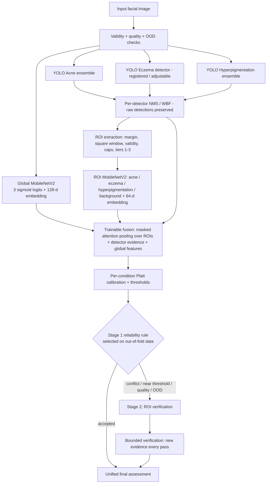

# V6 architecture

A picture of the same diagram is produced by the notebook (`figures/architecture_diagram.png`).

## Components and responsibilities
| Component | Input | Output | Trained on | Notes |
|---|---|---|---|---|
| Global MobileNetV2 (experiment B/C/D/D2) | 224×224 RGB, `(p/127.5)−1` | 3 logits (+ 128-d embedding); softmax experiments also give p(Normal) | `train` | selected on `validation` with a per-condition regression check vs V5 |
| YOLOv8 Acne / Eczema / Hyperpigmentation | letterboxed frame at their own `imgsz` | boxes + confidences (pool ≥ 0.05, deployed ≥ per-condition threshold) | **not retrained** | deployed NMS/WBF reproduced; unavailable ≠ zero detections |
| ROI MobileNetV2 | square context crop of a proposal, 224×224 | 4 scores (3 conditions + background) + 64-d embedding | `train` (labels from **verified** regions; proposals are the real YOLO proposals) | selected on `validation` |
| Fusion (7 variants) | global group, detector evidence, ROI set + mask | 3 logits | `fusion` split (cross-fitted) | modality dropout; variants implement the ablations |
| Calibration / thresholds | out-of-fold fusion logits | Platt `(a,b)` + F1 threshold per condition | `fusion` split OOF | skipped with a flag if too few positives/negatives |
| Stage-1 rule, Stage-2 band | calibrated probabilities, flags | accept / escalate | `fusion` split OOF | targets `TARGET_ACCEPTED_ERROR`; provisional |
| Verification controller | evidence provider | passes, stop reason | — (logic) | bounded; novelty, convergence, redundancy, time budget |
| Quality / OOD | image, global embedding | flags / distance | heuristics / `train` + `fusion` | unvalidated; never reported as Normal |
| Final result | all of the above | `FinalAssessment` JSON | — | raw CNN and YOLO outputs preserved |

## Why this design
* **Real information flow:** YOLO selects pixels that a second MobileNetV2 examines; its embedding and scores enter the fusion — YOLO is not merely overlaid on the CNN output.
* **No YOLO priority:** modality dropout, availability masks, and learning on verified labels; fixed "YOLO-wins" rules exist only as an *ablation baseline*.
* **Leakage control:** group-disjoint split frozen before annotation; ROI crops derived after the split; fusion trained on images that no CNN has seen; test opened once.
* **Honest uncertainty:** a calibrated probability within a validated band of its threshold is *uncertain*; absence is only "supported" where a detector covers the condition.
